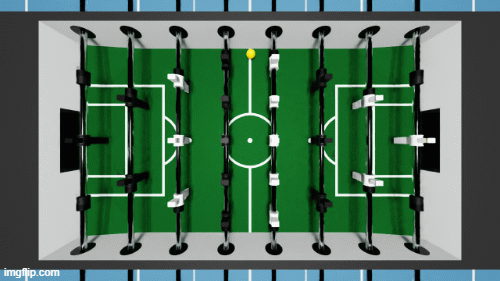

# Supplementary Material

This is the supplementary material for the TMLR submission _Anchored Object Representation for Reinforcement Learning_.

This directory contains the source code required to replicate our experiments, along with a GIF of ORBiT playing Foosball.

## Repository Structure

```
.
├── cleanrl_experiments/  # ORBiT (CleanRL PPO) on the Arcade Learning Environment and Tag
├── foosball/             # ORBiT and baselines on the Foosball robotic task
└── gif/                  # Foosball rollout GIF shown below
```

Each experiment folder has its own installation instructions, dependencies, and usage examples.

## Arcade Learning Environment

We evaluate ORBiT on Atari games from the Arcade Learning Environment, using an object-centric observation wrapper and a PPO training loop. Source code and instructions for the Atari experiments are in the [`cleanrl_experiments`](cleanrl_experiments/README.md) folder.

## Tag

We study how the choice of reference frame affects learning in Tag, an object-centric pursuit task in which the agent has to catch a goal among look-alike distractors. The Tag environment is in [`cleanrl_experiments/tag`](cleanrl_experiments/tag/README.md) and uses the same training scripts as the Atari experiments.

## Foosball

We evaluate ORBiT on a simulated robotic Foosball task built on Isaac Sim, comparing ORBiT against an object-centric transformer baseline (OCT) and a standard PPO baseline. Source code, configuration files, and pretrained checkpoints for the Foosball experiments are in the [`foosball`](foosball/README.md) folder.

### Foosball: ORBiT 3 vs. ORBiT 2 (slowed down 3x)


